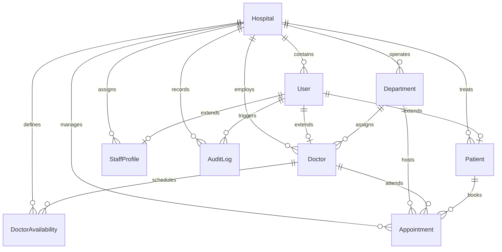

# HospitalX — Relational Database Design Specification

**Document Version:** 1.0.0  
**Engine:** MySQL 8.0+  
**ORM:** Prisma Client v6.4+  
**Date:** October 2026  

---

## 1. Entity-Relationship Model (ERD)

---

## 2. Relational Schema & Tables

### 2.1 `hospitals`
| Column | Type | Constraints | Description |
| :--- | :--- | :--- | :--- |
| `id` | VARCHAR(191) | PK, CUID | Unique hospital identifier. |
| `code` | VARCHAR(191) | UNIQUE, NOT NULL | Machine-readable hospital code (e.g. `HOSP-CENTRAL-01`). |
| `name` | VARCHAR(191) | NOT NULL | Human-readable hospital display name. |
| `address` | VARCHAR(191) | NULL | Physical facility location. |
| `phone` | VARCHAR(191) | NULL | Hospital contact telephone. |
| `email` | VARCHAR(191) | NULL | Official hospital correspondence email. |
| `isActive`| BOOLEAN | DEFAULT true | Facility operational toggle. |
| `createdAt`| DATETIME(3) | DEFAULT now() | Record creation timestamp. |
| `updatedAt`| DATETIME(3) | AUTO UPDATE | Last update timestamp. |

### 2.2 `users`
| Column | Type | Constraints | Description |
| :--- | :--- | :--- | :--- |
| `id` | VARCHAR(191) | PK, CUID | User account identifier. |
| `hospitalId` | VARCHAR(191) | FK -> hospitals(id) ON DELETE CASCADE | Tenant isolation scope. |
| `email` | VARCHAR(191) | NOT NULL | Login email address. |
| `passwordHash` | VARCHAR(191) | NOT NULL | Hashed password (bcrypt, 12 rounds). |
| `firstName` | VARCHAR(191) | NOT NULL | First name. |
| `lastName` | VARCHAR(191) | NOT NULL | Last name. |
| `role` | ENUM | DEFAULT 'PATIENT' | `SUPER_ADMIN`, `HOSPITAL_ADMIN`, `DOCTOR`, `NURSE`, `RECEPTIONIST`, `BILLING`, `PATIENT`. |
| `status` | ENUM | DEFAULT 'ACTIVE' | `ACTIVE`, `INACTIVE`, `SUSPENDED`. |
| `phone` | VARCHAR(191) | NULL | Primary contact phone. |
| `lastLoginAt` | DATETIME(3) | NULL | Timestamp of last successful authentication. |

* **Constraints & Indexes:**
  * Unique: `(hospitalId, email)`
  * Index: `(hospitalId, role)`
  * Index: `(hospitalId, status)`

### 2.3 `departments`
| Column | Type | Constraints | Description |
| :--- | :--- | :--- | :--- |
| `id` | VARCHAR(191) | PK, CUID | Department identifier. |
| `hospitalId` | VARCHAR(191) | FK -> hospitals(id) ON DELETE CASCADE | Hospital owner. |
| `name` | VARCHAR(191) | NOT NULL | Department name (e.g., "Cardiology"). |
| `code` | VARCHAR(191) | NOT NULL | Short code (e.g., "CARDIO"). |
| `description` | TEXT | NULL | Division overview and clinical scope. |
| `isActive` | BOOLEAN | DEFAULT true | Department availability flag. |

* **Constraints & Indexes:**
  * Unique: `(hospitalId, code)`
  * Unique: `(hospitalId, name)`
  * Index: `(hospitalId, isActive)`

### 2.4 `doctors`
| Column | Type | Constraints | Description |
| :--- | :--- | :--- | :--- |
| `id` | VARCHAR(191) | PK, CUID | Doctor profile identifier. |
| `hospitalId` | VARCHAR(191) | FK -> hospitals(id) ON DELETE CASCADE | Hospital owner. |
| `userId` | VARCHAR(191) | FK -> users(id) ON DELETE SET NULL, UNIQUE | Associated user login account. |
| `departmentId` | VARCHAR(191) | FK -> departments(id) | Assigned clinical department. |
| `name` | VARCHAR(191) | NOT NULL | Doctor full name (e.g., "Dr. Sarah Bennett"). |
| `specialty` | VARCHAR(191) | NOT NULL | Clinical subspecialty. |
| `licenseNumber` | VARCHAR(191) | NOT NULL | Medical board license identifier. |
| `qualification` | VARCHAR(191) | NULL | Academic degrees (e.g., "MD, FACC"). |
| `bio` | TEXT | NULL | Professional biography. |
| `consultationFee` | DECIMAL(10,2) | NULL | Standard outpatient consultation fee. |
| `rating` | DOUBLE | DEFAULT 5.0 | Average patient feedback rating. |
| `isActive` | BOOLEAN | DEFAULT true | Operational status. |

* **Constraints & Indexes:**
  * Unique: `(hospitalId, licenseNumber)`
  * Index: `(hospitalId, departmentId)`
  * Index: `(hospitalId, isActive)`

### 2.5 `doctor_availabilities`
| Column | Type | Constraints | Description |
| :--- | :--- | :--- | :--- |
| `id` | VARCHAR(191) | PK, CUID | Availability slot record ID. |
| `hospitalId` | VARCHAR(191) | FK -> hospitals(id) ON DELETE CASCADE | Hospital scope. |
| `doctorId` | VARCHAR(191) | FK -> doctors(id) ON DELETE CASCADE | Doctor reference. |
| `dayOfWeek` | INT | NOT NULL | `0` = Sunday through `6` = Saturday. |
| `startTime` | VARCHAR(191) | NOT NULL | Slot start time (`HH:mm`, 24-hr format). |
| `endTime` | VARCHAR(191) | NOT NULL | Slot end time (`HH:mm`, 24-hr format). |
| `slotDurationMinutes` | INT | DEFAULT 30 | Granularity per appointment slot. |
| `isActive` | BOOLEAN | DEFAULT true | Availability toggle. |

* **Constraints & Indexes:**
  * Unique: `(doctorId, dayOfWeek, startTime)`
  * Index: `(hospitalId, doctorId, dayOfWeek)`

### 2.6 `patients`
| Column | Type | Constraints | Description |
| :--- | :--- | :--- | :--- |
| `id` | VARCHAR(191) | PK, CUID | Patient master record ID. |
| `hospitalId` | VARCHAR(191) | FK -> hospitals(id) ON DELETE CASCADE | Hospital scope. |
| `userId` | VARCHAR(191) | FK -> users(id) ON DELETE SET NULL, UNIQUE | Associated portal login. |
| `medicalRecordNumber` | VARCHAR(191) | NOT NULL | Official hospital MRN (`MRN-YYYY-XXXXXX`). |
| `firstName` | VARCHAR(191) | NOT NULL | Patient legal first name. |
| `lastName` | VARCHAR(191) | NOT NULL | Patient legal last name. |
| `email` | VARCHAR(191) | NULL | Patient email address. |
| `phone` | VARCHAR(191) | NOT NULL | Patient contact phone number. |
| `dateOfBirth` | VARCHAR(191) | NULL | Demographics (`YYYY-MM-DD`). |
| `gender` | VARCHAR(191) | NULL | Demographics. |
| `bloodGroup` | VARCHAR(191) | NULL | Clinical blood type (e.g., `O+`, `A-`). |
| `allergies` | TEXT | NULL | Known drug/environmental allergies. |
| `insuranceProvider` | VARCHAR(191) | NULL | Health insurer name. |
| `insurancePolicyNumber` | VARCHAR(191) | NULL | Policy identifier. |
| `isActive` | BOOLEAN | DEFAULT true | Patient file status. |

* **Constraints & Indexes:**
  * Unique: `(hospitalId, medicalRecordNumber)`
  * Index: `(hospitalId, phone)`
  * Index: `(hospitalId, email)`
  * Index: `(hospitalId, isActive)`

### 2.7 `appointments`
| Column | Type | Constraints | Description |
| :--- | :--- | :--- | :--- |
| `id` | VARCHAR(191) | PK, CUID | Appointment record ID. |
| `hospitalId` | VARCHAR(191) | FK -> hospitals(id) ON DELETE CASCADE | Hospital scope. |
| `bookingId` | VARCHAR(191) | NOT NULL | Human-readable booking code (`WC-YYYY-XXXX`). |
| `patientId` | VARCHAR(191) | FK -> patients(id) | Patient reference. |
| `doctorId` | VARCHAR(191) | FK -> doctors(id) | Attending physician reference. |
| `departmentId` | VARCHAR(191) | FK -> departments(id) | Clinical department reference. |
| `appointmentDate` | VARCHAR(191) | NOT NULL | Appointment date (`YYYY-MM-DD`). |
| `startTime` | VARCHAR(191) | NOT NULL | Consultation start time (`HH:mm`). |
| `endTime` | VARCHAR(191) | NOT NULL | Consultation end time (`HH:mm`). |
| `visitType` | ENUM | DEFAULT 'IN_PERSON' | `IN_PERSON`, `TELEHEALTH`. |
| `status` | ENUM | DEFAULT 'PENDING' | `PENDING`, `CONFIRMED`, `COMPLETED`, `CANCELLED`, `NO_SHOW`, `REJECTED`. |
| `reason` | TEXT | NULL | Patient symptom description. |
| `cancellationReason` | TEXT | NULL | Required rationale when status is `CANCELLED`. |
| `notes` | TEXT | NULL | Clinical / administrative notes. |

* **Constraints & Concurrency Indexes:**
  * Unique: `(hospitalId, bookingId)`
  * Concurrency Conflict Index: `(hospitalId, doctorId, appointmentDate, startTime, status)`
  * Patient History Index: `(hospitalId, patientId, appointmentDate)`
  * Status Queue Index: `(hospitalId, status)`

### 2.8 `audit_logs`
| Column | Type | Constraints | Description |
| :--- | :--- | :--- | :--- |
| `id` | VARCHAR(191) | PK, CUID | Audit event log ID. |
| `hospitalId` | VARCHAR(191) | FK -> hospitals(id) ON DELETE CASCADE | Hospital scope. |
| `userId` | VARCHAR(191) | FK -> users(id) ON DELETE SET NULL | Actor user ID. |
| `action` | VARCHAR(191) | NOT NULL | Event verb (`AUTH_LOGIN`, `APPOINTMENT_BOOK`, etc.). |
| `entity` | VARCHAR(191) | NOT NULL | Target entity type (`Appointment`, `Patient`, `User`). |
| `entityId` | VARCHAR(191) | NULL | Target record primary key. |
| `details` | TEXT | NULL | Sanitized JSON metadata (secrets redacted). |
| `ipAddress` | VARCHAR(191) | NULL | Client IP address. |
| `userAgent` | VARCHAR(191) | NULL | Client browser / device user agent. |
| `createdAt` | DATETIME(3) | DEFAULT now() | Event creation timestamp. |

* **Constraints & Indexes:**
  * Index: `(hospitalId, createdAt)`
  * Index: `(hospitalId, entity, entityId)`
  * Index: `(hospitalId, action)`
