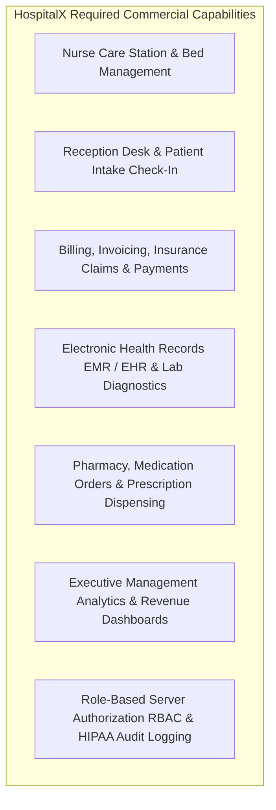
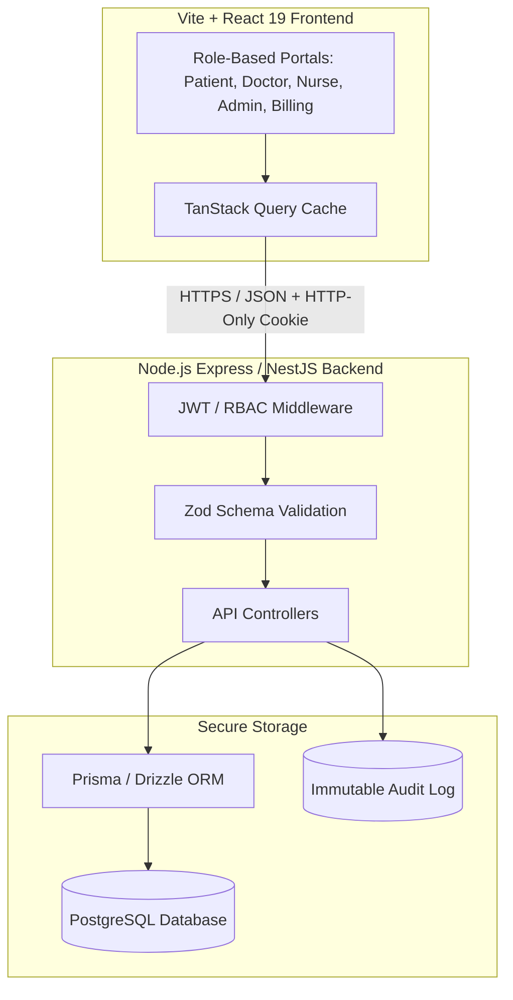

# Project Audit: HospitalX Management Platform

**Document Version:** 1.0.0  
**Audit Role:** Principal Software Architect, Senior React Engineer, Technical Auditor  
**Audit Type:** Read-Only Technical Due Diligence & Architecture Assessment  
**Repository Working Directory:** `d:/ceative/5PROJECTS/mainframe/mainframe`  
**Date:** October 2026  

---

## 1. Executive Summary

### 1.1 Business Context & Goal
The target system, designated as **HOSPITALX**, is envisioned as a multi-role commercial hospital-management platform. Its commercial viability requires robust operational workflows across seven distinct user personas:
1. **Patients:** Self-service registration, appointment booking, telehealth consultations, medical records, invoices.
2. **Doctors/Specialists:** Clinical queues, electronic health records (EHR/EMR), diagnosis notes, digital prescriptions.
3. **Nurses:** Patient vitals capture, bed allocation, triage stations, medication administration schedules.
4. **Receptionists:** Front-desk patient check-in, walk-in appointment scheduling, doctor availability management.
5. **Billing Staff:** Insurance verification, charge entry, claim generation, invoice processing, payment gateways.
6. **Hospital Administrators:** Department management, staff scheduling, clinical clearance, security audit logs.
7. **Hospital Management / Executives:** Bed occupancy rates, financial reporting, department revenue analytics, regulatory compliance.

### 1.2 Auditor Findings Summary
The current codebase is **not yet a hospital management platform**. It is primarily a **high-fidelity, client-side React marketing and patient-scheduling prototype** (built under the internal project name "WeCare Health" / "Mainframe") with a single-developer admin dashboard.

Key findings include:
* **Architecture:** 100% Client-Side Single Page Application (SPA). There is **no backend server, no API gateway, and no relational database**.
* **Data Layer:** Relies on client-side calls to Google Cloud Firestore coupled with browser `localStorage`. When Firestore permissions or networks fail, the app quietly degrades to single-browser `localStorage`.
* **Persona Support:** Only 2 personas exist in any functional capacity: a **Patient** booking wizard and a **Chief Administrator** triage screen. The remaining required personas (Nurses, Receptionists, Billing Staff, Management Executives) are **entirely missing**.
* **Clinical Data:** Doctor rosters, department listings, available consultation slots, and hospital credentials are **hardcoded in client TypeScript files**.
* **Security & Compliance:** High critical vulnerabilities. Admin clearance is evaluated exclusively in client browser state; demo accounts bypass password checks entirely; Firebase keys and client-side database writes lack server validation; and unencrypted Protected Health Information (PHI) is persisted directly in browser storage (violating HIPAA / GDPR requirements).
* **Repository Organization:** The repository root contains duplicate, orphaned directory trees (`/about`, `/src`, and a partial prototype `/we-care`) surrounding the primary project folder (`/mainframe`).

---

## 2. Verified Technology Stack

| Category | Technology | Verified Version | Configuration & Implementation Notes |
| :--- | :--- | :--- | :--- |
| **Core Framework** | React | `^19.2.8` | React 19.x with standard Hooks architecture (`useState`, `useEffect`, `useMemo`, `useCallback`, `useRef`). |
| **Runtime / DOM** | React DOM | `^19.2.8` | Client rendering via `createRoot` in `src/main.tsx`. |
| **Language** | TypeScript | `~6.0.2` | Strict compilation (`tsc -b`), ES2023 target, path alias `@/*` -> `./src/*`. Typecheck passes with **0 errors**. |
| **Build & Bundler** | Vite | `^8.2.2` | Configured with `@vitejs/plugin-react` and custom image rewrite middleware. Bundles to `dist/`. |
| **Routing** | React Router DOM | `^7.18.3` | SPA browser routing via `BrowserRouter`, `Routes`, and `Route` in `src/App.tsx`. |
| **Styling Engine** | Tailwind CSS | `^4.3.3` | Tailwind v4 using `@tailwindcss/vite` plugin and native CSS variables in `src/index.css`. |
| **CSS Preprocessing**| PostCSS & Autoprefixer | `^8.5.28` / `^10.5.5` | Standard automated CSS post-processing pipeline. |
| **Class Utilities** | `clsx` & `tailwind-merge` | `^2.1.1` / `^3.6.0` | Dynamic classname merging and deduplication. |
| **Animation (Primary)**| Motion / Framer Motion | `^13.2.0` | Viewport scroll reveals, layout animations, exit transitions (`AnimatePresence`). |
| **Animation (Scripted)**| GSAP | `^3.15.0` | Complex scripted timeline animations. |
| **Shader Graphics** | `@paper-design/shaders-react` | `^0.0.80` | WebGL canvas fluid shader pipelines. |
| **UI Primitives** | Radix UI Avatar | `^1.2.6` | Accessible fallback avatar primitive. |
| **Iconography** | Lucide React | `^1.41.0` | SVG icons across navigation, cards, and admin dashboard. |
| **Linting** | Oxlint | `^1.79.0` | 24 compiler/purity warnings identified, 0 fatal errors. |
| **Database SDK** | Firebase JS SDK | `^12.19.0` | Client-side Cloud Firestore and Firebase Authentication SDKs. |
| **Testing** | *None* | *Missing* | No unit, integration, or end-to-end testing frameworks installed. |
| **Backend Server** | *None* | *Missing* | No active server runtime (Node.js/Express, NestJS, FastAPI, etc.). |

---

## 3. Actual Repository Structure

```
d:\ceative\5PROJECTS\mainframe\mainframe\
│
├── about\                                <--- REDUNDANT / DUPLICATE
│   ├── components\
│   │   ├── ui\
│   │   │   └── departments-bento.tsx
│   │   ├── AboutSection.tsx
│   │   └── Navbar.tsx
│   ├── departments\
│   └── App.tsx
│
├── src\                                  <--- REDUNDANT / DUPLICATE
│   ├── components\
│   │   ├── ui\
│   │   │   └── departments-bento.tsx
│   │   └── Navbar.tsx
│   ├── departments\
│   └── App.tsx
│
├── we-care\                              <--- INACTIVE / PROTOTYPE
│   ├── public\
│   ├── src\
│   │   ├── components\
│   │   ├── App.tsx
│   │   └── index.css
│   ├── .env.example                      (Contains placeholder GEMINI_API_KEY)
│   ├── package.json                      (Lists unused 'express', '@google/genai')
│   ├── tsconfig.json
│   └── vite.config.ts
│
└── mainframe\                            <--- PRIMARY APPLICATION CORE
    ├── public\
    │   ├── doctor-images\                (16 doctor headshot JPGs + test crops)
    │   └── hospital\                     (Hospital interior photography JPGs)
    ├── scratch\                          (Legacy helper scripts: crop, search)
    ├── src\
    │   ├── about\                        (AboutPage.tsx, AboutSection.tsx)
    │   ├── admin\                        (AdminPortalPage.tsx - 143 KB single file)
    │   ├── appointment\                  (Booking wizard, schedule, storage.ts)
    │   ├── auth\                         (AuthContext.tsx, forms, biometric UI)
    │   ├── components\
    │   │   ├── ui\                       (Bento cards, coverflows, dead demos)
    │   │   ├── BackgroundVideo.tsx
    │   │   ├── CyberAvatar.tsx
    │   │   ├── FeaturePanel.tsx
    │   │   ├── Hero.tsx
    │   │   ├── HeroHeadline.tsx
    │   │   ├── LiquidCausticsBackground.tsx
    │   │   ├── LiquidGlassFilter.tsx
    │   │   └── Navbar.tsx
    │   ├── departments\                  (DepartmentsPage.tsx)
    │   ├── doctors\                      (DoctorsPage.tsx)
    │   ├── hooks\                        (useTypewriter.ts)
    │   ├── lib\                          (firebase.ts, department-colors.ts)
    │   ├── pages\                        (HomePage.tsx)
    │   ├── App.tsx                       (Root router & scroll-to-top)
    │   ├── index.css                     (Tailwind v4 base and custom utility classes)
    │   ├── main.tsx                      (React entry point)
    │   └── types.ts
    ├── package.json
    ├── tsconfig.json
    ├── tsconfig.app.json
    ├── tsconfig.node.json
    └── vite.config.ts
```

---

## 4. Feature-by-Feature Audit & Classification

Each component and capability is classified under one of the five required statuses:
* **[Verified Working]:** Thoroughly inspected and confirmed functional in execution logic.
* **[Present but Unverified]:** Component code exists, but relies on third-party cloud configurations that cannot be guaranteed without live external testing.
* **[Partially Implemented]:** Logic exists but lacks core enterprise safeguards, is fragmented, or has incomplete edge-case handling.
* **[Static or Hardcoded]:** UI presents rich data, but the data is hardcoded in client code and cannot be modified dynamically.
* **[Missing]:** Required for a commercial hospital management system, but absent in the codebase.

---

### 4.1 Routing & Navigation
* **Client Route Architecture (`/`, `/about`, `/departments`, `/doctors`, `/appointments`, `/book-appointment`, `/login`, `/register`, `/admin`)** — `[Verified Working]`  
  Routes are configured with `react-router-dom` in `src/App.tsx`. Page transition animations (`PageWrapper`) and route change scroll restoration (`ScrollToTop`) function properly.
* **Route Guards & Protected Routes** — `[Partially Implemented]`  
  No React Router `<ProtectedRoute>` wrapper exists. Protection is implemented as in-component conditional rendering (e.g., in `BookAppointmentPage.tsx` and `AdminPortalPage.tsx`). An unauthenticated user can still load the route bundle and execute page lifecycle hooks.

---

### 4.2 Authentication & User Profiles
* **Firebase Authentication (Email/Password & Google OAuth Popup)** — `[Present but Unverified]`  
  Firebase Auth SDK is wired in `src/auth/AuthContext.tsx`. Google OAuth domain validation depends on Firebase Console authorized domain settings.
* **Client-Side SHA-256 Offline Fallback Authentication** — `[Partially Implemented]`  
  When Firebase is unreachable, login falls back to comparing salted SHA-256 hashes in `localStorage` (`wecare_registered_accounts_v1`). Uses native Web Crypto `crypto.subtle`.
* **Demo / Guest One-Click Login** — `[Verified Working]`  
  Users can click "Instant Demo Patient Access (Alex Morgan)" or choose roles from a demo selector to immediately populate session state.
* **Password Verification for Demo Users** — `[Partially Implemented]` *(Critical Flaw)*  
  In `AuthContext.tsx` (lines 621–627), entering any demo user's email logs the user in regardless of what password is entered.
* **Biometric Visualizer UI** — `[Static or Hardcoded]`  
  `BiometricVisualizer.tsx` displays high-tech animated SVG reticles, fingerprint scans, and facial mesh geometry. However, it does not interface with WebAuthn or FIDO2 hardware biometrics; it is purely an animation timer.

---

### 4.3 Administrator Access & Hospital Governance
* **Chief Admin Portal (`/admin`)** — `[Partially Implemented]`  
  Contains extensive features (KPI metric counters, appointment queue filtering, table/card/list view modes, patient dossier inspection, status approve/reject actions, admin internal clinical notes, and CSV data export).  
  *Limitation:* All logic lives in a single monolithic 2,671-line file (`AdminPortalPage.tsx`).
* **Admin Authorization & Access Control** — `[Partially Implemented]` *(Security Vulnerability)*  
  Access is granted if `currentUser?.role === 'admin'` or if `currentUser?.email === 'rudrant.joshi@gmail.com'`. There is no cryptographic server verification or session token check. Modifying client state in memory bypasses the gate.
* **CSV Report Export** — `[Verified Working]`  
  The CSV export in `AdminPortalPage.tsx` includes sanitization against OWASP CSV Formula Injection (CWE-1236) by prepending single quotes to formula trigger characters (`=`, `+`, `-`, `@`).

---

### 4.4 Clinical Appointments & Scheduling
* **Patient Booking Wizard (`/book-appointment`)** — `[Partially Implemented]`  
  Allows patients to choose department, doctor, date, time slot, visit type (telehealth vs. in-person), insurance provider, and reason. Generates booking ID (`WC-2026-XXXX`).  
  *Limitation:* Does not perform server slot locking or conflict detection. Two concurrent patients can book the exact same doctor and time slot.
* **Patient Appointment Schedule (`/appointments`)** — `[Verified Working]`  
  `MyAppointmentsBento.tsx` displays active and historical appointments for the logged-in user, supports appointment cancellation, and provides status badge indicators.
* **Multi-Tab / Multi-Window State Synchronization** — `[Verified Working]`  
  `storage.ts` and `AdminPortalPage.tsx` dispatch and listen to custom window events (`wecare_appointments_changed`, `storage`) so state stays in sync across open tabs on the same machine.

---

### 4.5 Medical Departments & Doctor Rosters
* **Specialist Doctor Directory (`/doctors`)** — `[Static or Hardcoded]`  
  16 doctors across 8 departments are hardcoded in `ALL_DOCTORS` within `src/components/ui/doctors-bento.tsx`. Images are loaded from static local paths (`/doctor-images/`).
* **3D Coverflow Carousel Section** — `[Verified Working]`  
  Interactive 3D carousel (`doctors-coverflow-section.tsx`) with department filtering, rating indicators, and smooth touch drag interactions.
* **Clinical Departments Bento (`/departments`)** — `[Static or Hardcoded]`  
  8 clinical divisions (Cardiology, Neurology, Orthopedics, Pediatrics, Oncology, Dermatology, Emergency & Trauma, Radiology & Imaging) with static staff counts, case resolution percentages, and equipment specs.

---

### 4.6 Database, Storage & Cloud Services
* **Cloud Firestore Integration (`wecare-165d7`)** — `[Present but Unverified]`  
  Direct client writes to collections `appointments`, `users`, and `deleted_users`. Write success is subject to Firestore security rules.
* **Browser LocalStorage Persistence** — `[Verified Working]`  
  Caches appointments (`wecare_user_appointments_v2`) and registered accounts (`wecare_registered_accounts_v1`). Gracefully handles corrupted JSON parsing.
* **Server Database (PostgreSQL / MySQL / MongoDB)** — `[Missing]`  
  No relational or document database hosted or managed by a backend server.
* **Database ORM / Migrations (Prisma / Drizzle)** — `[Missing]`  
  No schema definitions, migration histories, foreign key constraints, or transaction support.

---

### 4.7 API Architecture & External Integrations
* **REST / GraphQL API Endpoints** — `[Missing]`  
  No backend API exists. All operations are direct frontend SDK or browser storage writes.
* **AI Diagnostic / Triage Assistant (`@google/genai`)** — `[Missing]`  
  Listed as a dependency in the prototype `we-care/package.json`, but no Gemini client or endpoint is implemented in the primary application.
* **Telehealth Video Streaming WebRTC** — `[Missing]`  
  "Telehealth" visit type exists as a string dropdown option, but no WebRTC, Agora, Twilio, or video streaming integration exists.

---

### 4.8 Design, Aesthetics & Responsiveness
* **Tailwind CSS v4 & Color Token System** — `[Verified Working]`  
  Cohesive design system featuring department color mapping (`department-colors.ts`), dark glassmorphism, and high-contrast typography.
* **Optical Shaders & Liquid Glass Effects** — `[Verified Working]`  
  Custom SVG displacement maps (`<LiquidGlassFilter />`) and WebGL shaders (`@paper-design/shaders-react`) render correctly without GPU crashing on modern browsers.
* **Mobile Responsiveness** — `[Partially Implemented]`  
  Responsive breakpoints (`sm:`, `md:`, `lg:`) are applied throughout, and the navigation includes a responsive drawer. However, heavy WebGL canvas shaders and multi-layer CSS blurs present a risk of frame-rate drops on budget mobile devices.

---

### 4.9 Error Handling, Logging & Quality Assurance
* **React Error Boundaries** — `[Missing]`  
  Neither `App.tsx` nor individual routes are wrapped in an `ErrorBoundary`. An uncaught JavaScript exception in a child component causes the entire React component tree to unmount into a blank screen.
* **Automated Testing Suite (Unit, Integration, E2E)** — `[Missing]`  
  Zero test specifications exist (`.test.ts` / `.spec.tsx`). No test runner (Vitest, Jest) is installed.
* **Error & Audit Logging Service (Sentry / Datadog)** — `[Missing]`  
  Errors are logged exclusively to the client browser console (`console.warn`, `console.error`).

---

## 5. Missing Commercial Hospital Features

For **HOSPITALX** to function as a commercial hospital-management platform, the following enterprise modules must be designed and built from scratch:



| Missing Module | Target Persona | Required Capabilities |
| :--- | :--- | :--- |
| **Nurse Station & Inpatient Care** | Nurses, Head Nurse | Bed allocation & ward visualizer; vital signs logging (BP, SpO2, Pulse, Temp); medication administration record (eMAR); nursing handoff notes. |
| **Reception & Queue Management** | Receptionists, Front Desk | Walk-in patient intake; physical check-in scanning (QR/Barcode); queue calling screen for waiting lounges; doctor on-duty status toggle. |
| **Billing, Invoicing & Insurance** | Billing Clerks, Cashiers | Charge master (procedure pricing); insurance eligibility verification; pre-authorization claims processing; payment gateway (Stripe/PayPal/POS); itemized invoice PDF generation. |
| **EHR / EMR & Diagnostic Reports** | Doctors, Lab Techs, Radiologists | Longitudinal medical history; ICD-10 / CPT diagnostic coding; lab order requests & result uploading (DICOM/PDF); digital prescription writing with drug-interaction checks. |
| **Pharmacy & Inventory** | Hospital Pharmacists | Drug inventory tracking; batch expiry monitoring; prescription dispense verification; low-stock automated alerts. |
| **Hospital Management Dashboards** | Hospital CEO, CFO, Medical Director | Departmental P&L analytics; bed turnaround time (BTT); average length of stay (ALOS); readmission rates; staff-to-patient ratios. |
| **Enterprise RBAC & Security Infrastructure** | System Admins, Compliance Officers | Server-validated JWT / OAuth2 sessions; granular permission matrix (read/write/delete per role); HIPAA immutable audit logs (who viewed which record at what timestamp). |

---

## 6. Security Concerns & Vulnerabilities

### Severity 1: Critical — Client-Side-Only Administrator Authorization
* **Location:** `src/admin/AdminPortalPage.tsx` (lines 159–161)
* **Vulnerability:** Admin clearance is determined via:
  ```typescript
  const isAdmin = currentUser?.role === 'admin' || currentUser?.email?.toLowerCase() === 'rudrant.joshi@gmail.com';
  ```
* **Risk:** Because this check runs entirely inside client React state, any user can open browser developer tools, edit localStorage or React component props, and bypass the admin clearance gate. There is no server API to reject unauthorized administrative actions.

### Severity 2: Critical — Hardcoded Demo Authentication Bypass
* **Location:** `src/auth/AuthContext.tsx` (lines 621–627)
* **Vulnerability:**
  ```typescript
  for (const key of Object.keys(DEMO_USERS) as UserRole[]) {
    if (cleanEmail === DEMO_USERS[key].email.toLowerCase()) {
      persistUser(DEMO_USERS[key]);
      return { success: true };
    }
  }
  ```
* **Risk:** If a user submits any demo account email (`alex.morgan@healthmail.com`, `dr.sarah@wecare.health`, `elena.vance@guardiancare.org`), authentication succeeds immediately **without verifying the password**.

### Severity 3: High — Hardcoded Third-Party API Keys Committed in Source Code
* **Location:** `src/lib/firebase.ts` (lines 11–19)
* **Vulnerability:** The complete Firebase web configuration (`apiKey`, `authDomain`, `projectId`, `storageBucket`, `messagingSenderId`, `appId`, `measurementId`) is hardcoded directly in TypeScript rather than abstracted into environment variables (`.env`).
* **Risk:** While Firebase API keys are technically client identifiers, committing them directly into version control without `.env` abstraction creates repository leakage, prevents multi-environment deployments (staging vs. production), and exposes project IDs to scanning bots.

### Severity 4: High — Unencrypted Protected Health Information (PHI) in LocalStorage
* **Location:** `src/appointment/storage.ts`
* **Vulnerability:** Patient names, email addresses, phone numbers, insurance providers, and clinical medical reasons for consultations are written as raw plaintext JSON strings into browser `localStorage` (`wecare_user_appointments_v2`).
* **Risk:** Violates healthcare data compliance standards (HIPAA Security Rule 45 CFR § 164.312, GDPR Art. 32). Any third-party script, browser extension, or malicious XSS payload executing in the origin can read all stored patient data.

### Severity 5: Medium — Direct Cloud Firestore Client Writes Without Server Validation
* **Location:** `src/appointment/storage.ts` (lines 198–205)
* **Vulnerability:** The client directly executes `setDoc(doc(db, 'appointments', bookingId), enrichedAppt)` without validation by an intermediary API layer.
* **Risk:** If Firestore rules are set to public (`allow write: if true`), arbitrary data can be injected into the database. If rules are strict, the application silently fails to sync and falls back to isolated `localStorage`.

---

## 7. Technical Debt

1. **Monolithic Admin Portal Component:**
   * `AdminPortalPage.tsx` spans **2,671 lines of code (143 KB)**. It conflates state management, real-time Firestore listeners, CSV generation, modal dialogs, search indexing, table views, and KPI math into a single file. This violates Single Responsibility principles and impedes team collaboration.
2. **Dead Code & Template Artifacts (308+ KB Bloat):**
   * `src/components/ui/interactive-blur-reveal.tsx` is **235 KB** and is never imported or used anywhere in the live application.
   * `src/components/ui/demo.tsx` (30 KB), `glyph-portal.tsx` (26 KB), `coverflow-carousel-demo.tsx`, `image-stream-hero-demo.tsx`, and `music-video-pin-stack-demo.tsx` are unreferenced demo artifacts.
3. **Intentional Code Duplication:**
   * In `src/components/ui/departments-bento.tsx` (line 36), helper components `TiltCard` and `AnimatedNumber` were deliberately copy-pasted rather than imported from shared utility libraries.
4. **Lack of Centralized API / Data Access Layer:**
   * Business logic directly accesses `localStorage` and `firebase/firestore` methods inline across UI components rather than routing requests through typed repositories or query hooks (e.g., TanStack Query).
5. **No Error Boundaries:**
   * No React `<ErrorBoundary>` is declared around root routes, risking full-page white screens upon unhandled UI render crashes.
6. **Linter Purity & Effect Warnings:**
   * Oxlint reports 24 warnings, specifically calling impure functions (`Date.now()`) during render and invoking `setState` synchronously inside `useEffect` bodies in `AdminPortalPage.tsx` and `AppointmentBento.tsx`.

---

## 8. Duplicate & Obsolete Files

| File / Folder Path | Status | Action Required |
| :--- | :--- | :--- |
| `about/` (root directory) | Obsolete duplicate | Delete. Source files already exist in `mainframe/src/about/`. |
| `src/` (root directory) | Obsolete duplicate | Delete. Source files already exist in `mainframe/src/`. |
| `we-care/` (root directory) | Obsolete starter prototype | Delete or archive. Replaced by `mainframe/`. |
| `mainframe/scratch/` | Obsolete scratch scripts | Delete scripts (`crop_or.ps1`, `fetch_unsplash.cjs`, `search_commons.cjs`). |
| `mainframe/src/components/ui/interactive-blur-reveal.tsx` | Unused dead code (235 KB) | Delete. |
| `mainframe/src/components/ui/interactive-blur-reveal-demo.tsx` | Unused dead demo | Delete. |
| `mainframe/src/components/ui/coverflow-carousel-demo.tsx` | Unused dead demo | Delete. |
| `mainframe/src/components/ui/image-stream-hero-demo.tsx` | Unused dead demo | Delete. |
| `mainframe/src/components/ui/music-video-pin-stack-demo.tsx` | Unused dead demo | Delete. |
| `mainframe/src/components/ui/gradient-card-showcase.tsx` | Unused dead code | Delete. |
| `mainframe/src/components/ui/card.tsx` | Unused primitive | Delete or adopt across bento cards. |

---

## 9. Recommended Architectural Improvements



### Phase 1: Clean Up & Establish Monorepo Structure
* Consolidate the active application into a standard `frontend/` (or `client/`) directory.
* Eliminate the duplicate folders (`about/`, `src/`, `we-care/`, and dead UI components).
* Establish environment variable management (`.env.example` and `.env.local`).

### Phase 2: Design and Deploy Backend API & Relational Database
* Build a dedicated Node.js (Express, Fastify, or NestJS) backend in TypeScript.
* Implement a production relational database (**PostgreSQL**) with an ORM (**Prisma** or **Drizzle**).
* Define relational schemas with referential integrity:
  * `users` (id, email, password_hash, role, profile_data)
  * `roles_permissions` (role_id, permission_code)
  * `departments` (id, name, description, color_code)
  * `doctors` (id, user_id, department_id, license_number, bio)
  * `appointments` (id, booking_id, patient_id, doctor_id, start_time, end_time, status, visit_type)
  * `audit_logs` (id, actor_id, target_entity, action, timestamp, ip_address)

### Phase 3: Implement Enterprise Role-Based Access Control (RBAC)
* Remove client-side authentication bypasses and localStorage credential stores.
* Implement server-side password hashing using **Argon2id** or **bcrypt**.
* Issue **HTTP-Only, Secure, SameSite JWT cookies** with refresh token rotation.
* Enforce server middleware route guards:
  * `POST /api/v1/appointments/:id/approve` -> Requires `admin` or `receptionist` role.
  * `GET /api/v1/patients/:id/records` -> Requires `doctor` or assigned `nurse` role.

### Phase 4: Build Missing Enterprise Modules
* **Nurse Station:** Inpatient bed tracker and vitals entry form.
* **Reception Desk:** Daily queue management and check-in confirmation screen.
* **Billing & Invoices:** Charge entry, invoice generator, and receipt download.
* **Doctor Clinical View:** Patient EHR history timeline and clinical notes.

---

## 10. Unresolved Architectural Questions for Stakeholders

1. **Deployment Architecture:** Will the commercial platform be hosted as a centralized SaaS product (multi-tenant on AWS/GCP) or installed on-premises inside individual hospital data centers with air-gapped security?
2. **Regulatory & Compliance Scope:** Which compliance standards must be strictly satisfied prior to pilot launch (HIPAA in the US, GDPR in the EU, NABH/DISHA in India)? This dictates whether client data can touch third-party cloud services like Firebase.
3. **Identity Provider Strategy:** Should staff (doctors, nurses, admins) authenticate via hospital Single Sign-On (SSO) using SAML/OAuth (e.g., Azure AD, Okta), while patients authenticate via Email/Password and Google OAuth?
4. **Data Migration Requirements:** Does the hospital have existing Electronic Medical Record (EMR) or Health Information System (HIS) databases (such as Epic, Cerner, or HL7/FHIR feeds) that HOSPITALX must integrate with via APIs?
5. **Telehealth Infrastructure:** Is telehealth expected to support integrated real-time video/audio calling within the browser, or will it integrate with third-party providers (Zoom Healthcare API, Twilio, Daily.co)?
